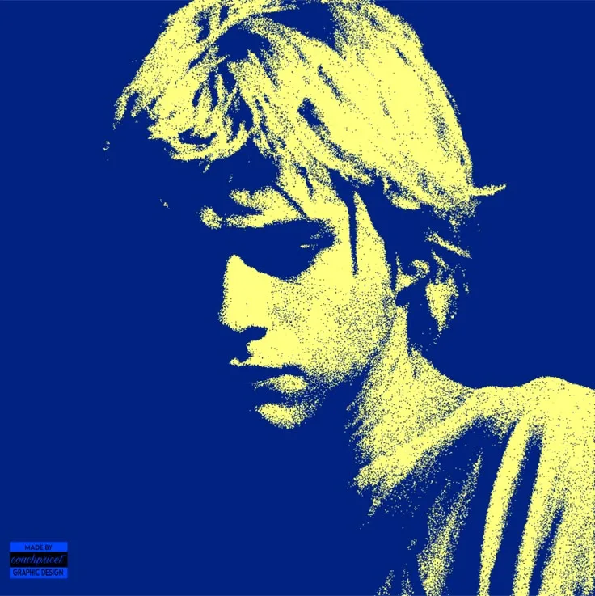

# Pavan Badiger — Portfolio

<p align="center">
  <strong>Hmmmm. Jst Build Gng!!</strong><br />
  AI &amp; Data Science student · Belagavi, India
</p>

<p align="center">
  <a href="https://pavn31.dpdns.org"></a>
  <a href="https://github.com/Pavn31"></a>
  <a href="mailto:pavanbadiger@gmail.com"></a>
</p>

Live portfolio: [pavn31.dpdns.org](https://pavn31.dpdns.org/)

<p align="center">
  
</p>

## About the redesign

This is a handcrafted, dependency-free portfolio designed as an editorial workspace for ideas, experiments, and useful software. The new interface is intentionally direct: strong typography, generous negative space, structured project cards, and a signal-orange accent over a near-black canvas.

The experience is organized around three questions:

- What has Pavan built?
- How does he think and work?
- How can someone start a conversation?

## Console signature

```text
╔══════════════════════════════════════╗
║  PAVAN BADIGER / AI × DATA × DESIGN  ║
║  CURIOUS BY NATURE. BUILDER BY CHOICE║
╚══════════════════════════════════════╝
```

## Design system

- Near-black surfaces with warm white typography and signal-orange highlights
- Archivo for display type and IBM Plex Mono for labels, metadata, and technical details
- Grid-based layouts that adapt across desktop, tablet, and mobile screens
- Editorial section numbering, project metadata, and figure captions
- Subtle reveal animations driven by `IntersectionObserver`
- Visible focus states and reduced-motion support for accessible interaction
- No framework, build pipeline, or runtime dependency

## Portfolio sections

| Section | Purpose |
| --- | --- |
| Hero | Introduction, portrait, location, study status, and primary actions |
| Selected work | Smart Blind Stick, Ghost Files, and Catch Phish project cards |
| About | Pavan's approach to AI, software, embedded systems, and IoT |
| Contact | Email, GitHub, LinkedIn, and location links |

## Selected work

### Smart Blind Stick

An assistive embedded device using ultrasonic obstacle detection, buzzer alerts, optional GPS tracking, and emergency SMS support.

**Built with:** Arduino, HC-SR04, GPS, GSM

### Ghost Files

A cross-platform desktop utility for finding ghost files, duplicates, large files, caches, and broken symlinks, with a health score and safe trash-based cleanup.

**Built with:** Python, PySide6

### Catch Phish

A community project that helps users analyze suspicious URLs and identify potential phishing threats.

**Built with:** HTML, CSS, JavaScript, Python, FastAPI

## Tech stack

| Layer | Tools |
| --- | --- |
| Structure | Semantic HTML5 |
| Visuals | CSS custom properties, Grid, Flexbox, responsive rules |
| Interaction | Vanilla JavaScript, IntersectionObserver |
| Typography | Archivo, IBM Plex Mono, Google Fonts |
| Delivery | Static hosting, no build step |

## Project structure

```text
Portfolio/
├── index.html       # Portfolio content and semantic sections
├── style.css        # Editorial layout, theme, responsive rules, and motion
├── script.js        # Reveal animations and scroll interactions
├── README.md
└── assets/
    ├── Icon.jpeg    # Favicon and project icon
    ├── Profile.jpeg # Hero portrait
    ├── Profile.webp # Optimized hero portrait
    └── ascii-banner.txt # Terminal-style signature
```

## Run locally

No dependencies or build step are required.

```bash
git clone https://github.com/Pavn31/portfolio.git
cd portfolio
python3 -m http.server 8000
```

Open [http://localhost:8000](http://localhost:8000).

## Customise

- Update copy, project details, links, and contact information in `index.html`.
- Adjust the visual system and responsive behavior in `style.css`.
- Update reveal and scroll behavior in `script.js`.
- Replace `assets/Profile.jpeg` or `assets/Profile.webp` to change the portrait.
- Replace `assets/Icon.jpeg` to change the favicon.

## Connect

- Email: [pavanbadiger@gmail.com](mailto:pavanbadiger@gmail.com)
- GitHub: [@Pavn31](https://github.com/Pavn31)
- LinkedIn: [pavn-badiger](https://www.linkedin.com/in/pavn-badiger/)
- Live portfolio: [pavn31.dpdns.org](https://pavn31.dpdns.org/)

---

<p align="center">Built with curiosity, intention, and vanilla web technologies.</p>
