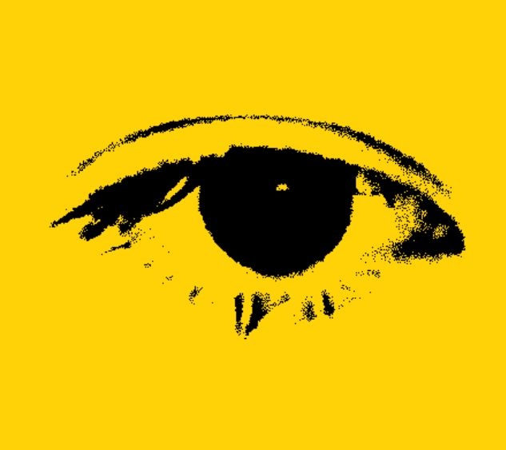

# Pavan Badiger / Portfolio

<p align="center">
  <strong>Curious by nature. Builder by choice.</strong><br />
  Artificial Intelligence &amp; Data Science student · Belagavi, India
</p>

<p align="center">
  <a href="https://pavn31.dpdns.org"></a>
  <a href="https://github.com/Pavn31"></a>
  <a href="mailto:pavanbadiger@gmail.com"></a>
</p>

Live portfolio: [https://pavn31.dpdns.org/](https://pavn31.dpdns.org/)

<p align="center">
  
</p>

## What this is

A cinematic, dark personal portfolio built from scratch with semantic HTML, custom CSS, and vanilla JavaScript. It is designed to feel like a personal command centre: part profile, part project archive, part contact point.

## Visual language

- Dark canvas with layered gradients and a focused visual hierarchy
- CSS-built floating spaceship and orbital hero artwork
- Layered 3D depth, glass surfaces, and tactile hover states
- Warm orange and electric blue accents over deep navy surfaces
- Responsive layouts for desktop, tablet, and mobile
- Accessible focus states and reduced-motion support



## Console signature

```text
╔══════════════════════════════════════╗
║  PAVAN BADIGER / AI × DATA × DESIGN  ║
║  CURIOUS BY NATURE. BUILDER BY CHOICE║
╚══════════════════════════════════════╝
```

## Tech stack

| Layer | Tools |
| --- | --- |
| Structure | HTML5, semantic sections |
| Visuals | CSS custom properties, Grid, Flexbox, 3D transforms |
| Interaction | Vanilla JavaScript |
| Typography | Unbounded, DM Mono, Google Fonts |
| Delivery | Static, framework-free, build-free |

## Project structure

```text
Portfolio/
├── index.html              # Portfolio content and semantic layout
├── style.css               # Space theme, 3D effects, responsive rules
├── script.js               # Interactions, tilt, cards, and navigation
├── README.md
└── assets/
    ├── Icon.jpeg           # Favicon / project icon
    ├── Profile.jpeg        # Hero portrait
    └── ascii-banner.txt    # Terminal-style signature
```

## Run locally

No dependencies or build step are required.

```bash
git clone https://github.com/Pavn31/portfolio.git
cd portfolio
python -m http.server 8000
```

Open [http://localhost:8000](http://localhost:8000).

## Customise

- Edit copy, projects, links, and contact details in `index.html`.
- Change the palette from the `:root` variables in `style.css`.
- Replace `assets/Profile.jpeg` to update the hero portrait.
- Replace `assets/Icon.jpeg` to update the favicon.
- Tune the spaceship and motion rules near the bottom of `style.css`.

## Connect

- Email: [pavanbadiger@gmail.com](mailto:pavanbadiger@gmail.com)
- GitHub: [@Pavn31](https://github.com/Pavn31)
- LinkedIn: [pavn-badiger](https://www.linkedin.com/in/pavn-badiger/)
- Live portfolio: [pavn31.dpdns.org](https://pavn31.dpdns.org)

## License

This is a personal portfolio project. Feel free to take inspiration from it, but please do not copy it wholesale as your own portfolio.
